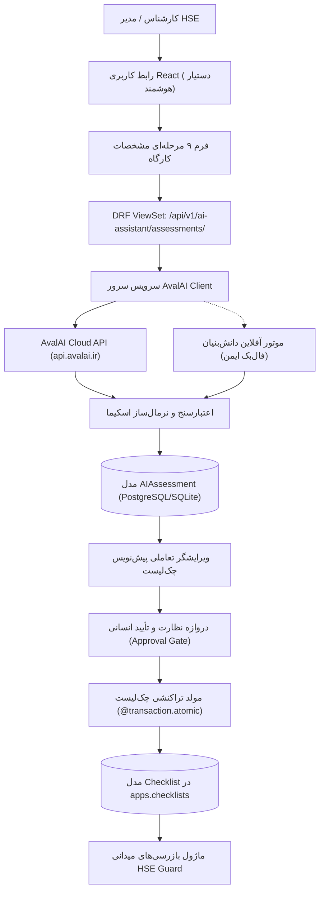

# معماری دستیار هوشمند HSE (Phase 19)
## یکپارچه‌سازی با AvalAI، استخراج مخاطرات و صدور چک‌لیست بازرسی

---

## ۱. نمای کلی سیستم

دستیار هوشمند HSE Guard در فاز ۱۹ به عنوان یک زیرسیستم پیشرفته هوش مصنوعی جهت تحلیل ساختاریافته شرایط کارگاهی، کشف مخاطرات پنهان، ارزیابی کمی ریسک و تدوین پیش‌نویس چک‌لیست‌های تخصصی بازرسی با نظارت و تأیید مستقیم انسانی (Human-in-the-Loop) پیاده‌سازی شده است.

این ماژول از ارائه‌دهنده ملی هوش مصنوعی **AvalAI** (سازگار با پروتکل استاندارد OpenAI Chat Completions API) استفاده می‌کند و از معماری ایزوله چندمستأجره (Multi-Tenant) سامانه HSE Guard تبعیت می‌نماید.

---

## ۲. مدل‌های داده (Data Models)

### ۲.۱. مدل `AIAssessment`
مدل اصلی ذخیره‌سازی فرآیند ارزیابی در مسیر `backend/apps/ai_assistant/models.py`:
- **`organization`**: ارجاع به سازمان مستأجر (Tenant Isolation).
- **`workplace`**: ارجاع به واحد کارگاهی ثبت‌شده.
- **`title`**: عنوان یکتای ارزیابی.
- **`workplace_data`** (`JSONField`): اطلاعات ساختاریافته ۹ گانه کارگاه.
- **`status`**: وضعیت چرخه عمر ارزیابی:
  - `draft`: پیش‌نویس اولیه اطلاعات کارگاه.
  - `analyzing`: در حال ارتباط و پردازش توسط هوش مصنوعی.
  - `analyzed`: تحلیل با موفقیت انجام شد و خطرات استخراج گردید.
  - `editing`: کاربر در حال ویرایش پیش‌نویس چک‌لیست است.
  - `validated`: پیش‌نویس چک‌لیست اعتبارسنجی ساختاری شد.
  - `approved`: ارزیابی توسط کارشناس/مدیر تأیید رسمی گردید.
  - `checklist_generated`: چک‌لیست رسمی تولید و پیوند داده شد.
  - `analysis_failed`: بروز خطا در تحلیل با ذخیره پیام خطا.
- **`analysis_result`** (`JSONField`): خروجی نرمال‌شده و اعتبارسنجی‌شده مدل هوش مصنوعی مطابق اسکیمای بخش ۹.
- **`checklist_draft`** (`JSONField`): پیش‌نویس تعاملی بخش‌ها و بندهای چک‌لیست.
- **`ai_model`**: نام مدل هوش مصنوعی پردازش‌کننده (`gpt-4o-mini`، `gpt-4o` و ...).
- **`provider_metadata`** (`JSONField`): توکن‌های مصرفی، مدت زمان تاخیر، شناسه درخواست و کد وضعیت.
- **`approved_by`** و **`approved_at`**: ردپای انسانی ناظر تأییدکننده.
- **`approval_notes`**: مستندات و توضیحات تأیید ناظر.
- **`generated_checklist`**: پیوند کلید خارجی به چک‌لیست تولیدشده رسمی در `apps.checklists.models.Checklist`.

### ۲.۲. مدل `AIGenerationLog`
ثبت کامل لاگ‌های ممیزی و مانیتورینگ کلیه فراخوانی‌های هوش مصنوعی شامل مدت زمان پاسخ، تعداد توکن‌های ورودی/خروجی و وضعیت موفقیت یا خطا.

---

## ۳. امنیت و مدیریت کلید API

- **محرمانگی ۱۰۰٪ کلید**: کلید `AVALAI_API_KEY` منحصراً در لایه سرور Django (`avalai_client.py`) خوانده و مصرف می‌شود. هیچ متغیر یا هدر حاوی کلید به کلاینت، مرورگر، لاگ‌ها یا مخزن گیت منتقل نمی‌شود.
- **کنترل دسترسی چندمستأجره**: کاربران تنها مجاز به مشاهده، ارزیابی، ویرایش و صدور چک‌لیست برای سازمان‌های تحت عضویت خود می‌باشند (`accessible_organization_ids`).
- **دروازه کنترل نقش**: صدور و تأیید نهایی ارزیابی نیازمند دسترسی مدیریتی یا بازرسی (`can_review`) است.

---

## ۴. ارتباط با ماژول بازرسی و تولید تراکنشی چک‌لیست

تابع `generate_real_checklist_from_assessment`:
1. وضعیت ارزیابی را بررسی می‌کند (`AIAssessment.Status.APPROVED`).
2. از ایجاد تکراری چک‌لیست محافظت می‌کند (Idempotency Guard).
3. در یک تراکنش اتمیک دیتابیس (`@transaction.atomic`):
   - رکورد جدید `Checklist` را در سازمان مربوطه ایجاد می‌کند.
   - بندهای بازرسی را به همراه نام بخش، معیار پذیرش، الزام شواهد و بج بحرانی بودن (`[بحرانی]` برای موارد Critical Stop-Work) در `ChecklistItem` ثبت می‌کند.
   - شناسه چک‌لیست ایجادشده را در ارزیابی پیوند داده و رویداد را در لاگ حسابرسی سامانه ثبت می‌کند.
