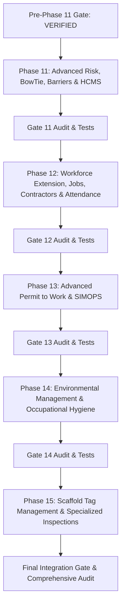

# HSE Guard — Master Execution Plan: Phases 11–15

## 1. Executive Summary & Quality Contract

This document governs the phased execution of **Phases 11 through 15** for the HSE Guard platform.
The pre-Phase-11 audit and product completion gate has been fully verified:
- Backend: 211 tests passing, 0 migrations drift, 0 system check issues.
- Frontend: 48 tests passing, clean TypeScript production build.
- Working tree: Clean (`main` at `d6aaaf9`).

### Strict Execution Constraints
1. **No Docker, no Git commit/push, no destructive Git actions.**
2. **Never reset or damage `backend/db.sqlite3`.**
3. **No mock production data or fake buttons.**
4. **All endpoints enforce strict organization-scoped isolation (`tenant_id`/`organization_id`).**
5. **Strict sequential execution:** Phase 11 → Gate 11 → Phase 12 → Gate 12 → Phase 13 → Gate 13 → Phase 14 → Gate 14 → Phase 15 → Final Integration Gate.

---

## 2. Phase Breakdown & Dependency Graph

---

## 3. Detailed Phase Work Breakdown

### Phase 11: Advanced Risk Management, BowTie, Barriers & HCMS
- **Target App:** `apps/risks` (and models in `apps/risks/models.py`)
- **Key Models:**
  - `BowTieDiagram`: Linked to Hazard/Top Event, Organization, Workplace, status, review cycle.
  - `Threat`: Causes leading to the Top Event.
  - `Consequence`: Potential outcomes if Top Event occurs.
  - `Barrier`: Preventive (on Threat) or Mitigative (on Consequence). Type (Engineering, Administrative, Procedural, Human), critical flag, barrier owner.
  - `BarrierAssessment`: Periodic evaluation with scale (`effective`, `partially_effective`, `ineffective`, `not_tested`), evidence notes, assessed_by, assessed_at.
  - `HCMSMatrix`: Hazard Control Management System control mapping, matrix scoring, residual risk calculation, reassessment triggers.
- **Integration Points:**
  - Connect failed barriers to Findings/CAPA (`apps/findings`, `apps/capa`).
  - Trigger risk reassessment from related Incidents (`apps/incidents`).
- **Frontend:**
  - Visual BowTie diagram viewer/builder, Barrier health status board, HCMS control matrix.
- **Tests & Verification:**
  - Unit/API tests for BowTie models, barrier assessments, calculation determinism, tenant isolation.

---

### Phase 12: Workforce Extension, Jobs, Contractors & Attendance
- **Target App:** `apps/workforce`
- **Key Models:**
  - `JobPosition`: Catalog of positions with required competencies, risks, and qualifications.
  - `EmployeeJobAssignment`: History of employee assignments to jobs.
  - `ContractorCompany`: Contractor registry, registration number, contact, organization scope, approval status, contract dates.
  - `ContractorDocument`: Insurance, licenses, safety certificates with expiry dates and verification status.
  - `ContractorWorker`: Workers affiliated with contractors (login not required, but tracked for competency and permits).
  - `ContractorEvaluation`: Periodic HSE evaluation, audit score, findings.
  - `AttendanceRecord`: Shift entry/exit, site location, recorded source, validation flag.
- **Integration Points:**
  - Link `ContractorWorker` and `Employee` qualifications to `apps/permits`.
- **Frontend:**
  - Contractor management portal, Job-to-competency matrix, Attendance roster view.
- **Tests & Verification:**
  - Multi-tenant isolation, expiry alerts, unauthenticated worker handling, job change history preservation.

---

### Phase 13: Advanced Permit to Work & Operational Safety
- **Target App:** `apps/permits`
- **Key Enhancements:**
  - Guarded state machine: `draft` -> `review` -> `approved` -> `active` -> `suspended` -> `resumed` -> `closed` (or `cancelled`, `rejected`, `expired`).
  - Pre-job safety checks: Isolation/LOTO references, contractor verification, worker competency checks, asset calibration checks, scaffold tag validation.
  - Simultaneous Operations (SIMOPS) detection: Conflict warnings for overlapping workplace/time windows.
  - Comprehensive shift handover integration: Open permits, hazard handover, isolations.
- **Frontend:**
  - Multi-step permit wizard, SIMOPS conflict alert widget, field mobile-friendly permit card with safety-critical warnings.
- **Tests & Verification:**
  - Self-approval block, invalid competency block, out-of-service equipment block, SIMOPS conflict tests.

---

### Phase 14: Environmental Management & Occupational Hygiene
- **New App:** `apps/environment`
- **Key Models:**
  - `EnvironmentalAspect`: Identification of aspects, normal/abnormal/emergency conditions, significance rating.
  - `WasteRecord`: Waste stream, hazardous classification, quantity, unit, storage location, transfer/disposal details, tracking code.
  - `WastewaterSample`: Sampling point, date/time, sampler, parameters (BOD, COD, TSS, pH, etc.), measured values, configured limits, compliance status.
  - `HygieneMonitoring`: Workplace monitoring (Noise, Heat/WBGT, Lighting, Dust, Toxic gases), workplace location, measured value, 8-hour TWA/TLV threshold evaluation.
  - `EnvironmentalThreshold`: Configurable threshold/reference limits (internal vs legal) with units.
- **Integration Points:**
  - Exceedances generate automatic NonConformity/CAPA records.
- **Frontend:**
  - Environmental dashboard, Waste register, Hygiene sampling trends, Threshold configuration.
- **Tests & Verification:**
  - Unit validation, limit evaluation calculations, automated CAPA generation, tenant isolation.

---

### Phase 15: Scaffold Tag Management & Specialized Inspections
- **New App:** `apps/scaffolds`
- **Key Models:**
  - `Scaffold`: Unique code, location/workplace, contractor, type, load class, duty rating, erection date, status (`erection`, `inspection_pending`, `approved_green`, `restricted_yellow`, `unsafe_red`, `dismantled`).
  - `ScaffoldInspection`: Regular inspection, inspector, findings, structural checklist, next inspection due date (e.g. 7-day interval).
  - `ScaffoldTagLog`: History of tag status changes, reasons, authorized inspector signature.
- **Integration Points:**
  - Block high-risk Permits in `apps/permits` if required scaffold is `unsafe_red`, `inspection_pending`, or inspection overdue.
- **Frontend:**
  - Scaffold register, visual Tag status badges (Green/Yellow/Red), QR/Barcode print-ready view, inspection log form.
- **Tests & Verification:**
  - State transitions, inspection expiry calculation, permit blocking logic, multi-tenant safety.

---

## 4. Phase Execution & Acceptance Tracking

| Phase | Description | Status | Backend Tests | Frontend Build | Demo Seed | Gate Report |
|---|---|---|---|---|---|---|
| **Phase 11** | Advanced Risk, BowTie & HCMS | **VERIFIED** | 30/30 Pass | Clean (0 errors) | Verified | `11_advanced_risk_bowtie_hcms.md` |
| **Phase 12** | Workforce, Contractors & Attendance | **VERIFIED** | 22/22 Pass | Clean (0 errors) | Verified | `12_workforce_contractors_attendance.md` |
| **Phase 13** | Advanced PTW & SIMOPS | IN PROGRESS | Pending | Pending | Pending | Pending |
| **Phase 14** | Environmental & Occupational Hygiene | PLANNED | Pending | Pending | Pending | Pending |
| **Phase 15** | Scaffold Tag Management | PLANNED | Pending | Pending | Pending | Pending |
